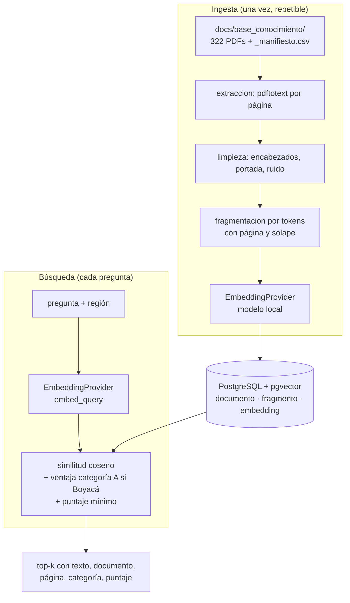

# CoffeCrop — Plan de Arquitectura: Base de Conocimiento Cafetero

> Basado en `spec.md` (en esta carpeta) y `constitution.md`. Cubre cómo se construye la ingesta, el almacenamiento y la búsqueda. **No** incluye el endpoint del asistente ni la app (features siguientes).

## 0. Qué se verificó antes de planificar (2026-10-20)
Para no planificar sobre suposiciones se comprobó en este equipo:
- **Python 3.14.7**: existen paquetes ya compilados (wheels) para `torch`, `sentence-transformers`, `onnxruntime`, `psycopg[binary]`, `pgvector`, `numpy` y `tokenizers`. No hace falta bajar de versión de Python.
- **Docker 29.7.2** funcionando; la imagen `pgvector/pgvector:pg16` existe. **53 GB libres** en `C:`.
- **Texto de los PDFs** (muestra de 6 documentos y de los 584 en el análisis previo): `pdftotext` devuelve texto en buen orden de lectura y **sin guiones de corte de línea**. Pero hay ruido que la limpieza debe tratar:
  - **Encabezados repetidos en el Manual** (p. ej. "cafetero colombiano" en 174 de 354 páginas del Tomo 2).
  - **Portada con datos administrativos** en cada Avance (autores, ORCID, DOI, ISSN, imprenta, dirección): no aportan a ninguna búsqueda y contaminarían los resultados.
  - **Tablas convertidas en líneas cortas y números** (en el Avance 465, ~300 de 732 líneas tienen ≤ 3 caracteres). Importa porque los calendarios de siembra del "oriente de Boyacá" (categoría A) viven en tablas.

## 1. Arquitectura General



**Capas:** extracción y limpieza (puras, sin base de datos) → fragmentación (pura) → proveedor de embeddings (intercambiable) → repositorio de base de datos → casos de uso (`ingestar`, `buscar`, `evaluar`) → CLI. Cada capa se prueba por separado (Single Responsibility, `constitution.md`).

**Por qué así:** la parte que cambia con más frecuencia (el modelo) queda detrás de una interfaz; la parte difícil de acertar (limpieza y fragmentación) es código puro y fácil de probar con textos de ejemplo, sin base de datos ni modelo.

## 2. Stack Técnico — Dependencias (✅ aprobadas por el usuario el 2026-10-20)

`constitution.md` exige preguntar antes de agregar dependencias. Todas son nuevas y fueron **aprobadas**; cualquier otra que aparezca durante la ejecución vuelve a requerir aprobación:

| Paquete | Para qué | Licencia | Alternativa descartada |
|---|---|---|---|
| `sentence-transformers` (trae `torch`) | Cargar y ejecutar el modelo de embeddings local | Apache-2.0 / BSD | `fastembed` (más liviano, pero cubre menos modelos y hay que verificar cada uno) |
| `psycopg[binary]` (v3) | Cliente de PostgreSQL | LGPL | `asyncpg`/SQLAlchemy: innecesarios aquí |
| `pgvector` (paquete Python) | Enviar/recibir vectores con psycopg | MIT | Armar el literal `'[0.1,0.2,…]'` a mano |
| `pytest` (solo desarrollo) | Pruebas | MIT | — |

**Sin dependencias nuevas** para: extracción de PDF (se sigue usando el programa `pdftotext` de Poppler, ya validado sobre los 584 PDFs, llamado como proceso aparte), CLI (`argparse` de la librería estándar), configuración (variables de entorno + `dataclass`), migraciones (un archivo SQL versionado), hashes (`hashlib`).

**Decisiones de herramienta que conviene saber:**
- **`pdftotext` en vez de PyMuPDF:** PyMuPDF extrae bien, pero su licencia (AGPL) obliga a abrir el código de lo que lo use o a comprar licencia comercial; como la app podría ser comercial, se evita. `pdftotext` como proceso externo no genera ese problema. Requisito: Poppler en el `PATH` (hoy viene con Git para Windows); la ruta es configurable con `PDFTOTEXT_BIN`.
- **Sin índice vectorial (HNSW) al inicio:** con ~10.000 fragmentos, una búsqueda exacta recorre unos 30 MB de vectores en milisegundos. Un índice complicaría el manejo de varios modelos con distinta dimensión y no aporta a esta escala. Se añade solo si las mediciones lo piden.

## 3. Modelo de embeddings

### 3.1 Interfaz (US-004, BR-004)
```python
class EmbeddingProvider(Protocol):
    nombre_modelo: str
    dimension: int
    max_tokens: int                      # longitud máxima que el modelo lee
    def contar_tokens(self, texto: str) -> int: ...
    def embed_documents(self, textos: list[str]) -> list[list[float]]: ...
    def embed_query(self, texto: str) -> list[float]: ...
```
Hay **dos métodos distintos** a propósito: modelos como e5 exigen prefijos distintos para pasajes (`passage: …`) y preguntas (`query: …`); BGE-M3 no. Esa diferencia queda encerrada dentro de cada proveedor y el resto del código no la ve. Un modelo de pago futuro será otra clase que cumple la misma interfaz.

### 3.2 Candidatos (cifras aproximadas de las fichas públicas; se verifican al instalar)
| Modelo | Tamaño | Dimensión | Lee hasta | Notas |
|---|---|---|---|---|
| `intfloat/multilingual-e5-base` | ~280 M parámetros | 768 | 512 tokens | Rápido; punto de partida |
| `intfloat/multilingual-e5-large` | ~560 M | 1024 | 512 tokens | Más calidad, ~2x más lento |
| `BAAI/bge-m3` | ~570 M | 1024 | 8.192 tokens | Admite fragmentos largos; el más pesado |

**Se implementa primero con `multilingual-e5-base`** y la tarea de evaluación compara los tres con las preguntas de prueba (US-005); el ganador queda como modelo activo. Todos tienen licencia MIT y se descargan una sola vez desde Hugging Face (hace falta internet esa vez).

### 3.3 Tamaño de fragmento según el modelo (**DEC-009, aceptada el 2026-10-20**)
DEC-003 fijó fragmentos de ~600 tokens, pero la familia e5 solo lee **512**: un fragmento más largo se cortaría en silencio y se perdería la cola del texto. Decisión (ya reflejada en `spec.md`, BR-001 y DEC-009):
- El tamaño objetivo **no es fijo**: es `min(600, max_tokens del modelo − 60)`. Con e5 ≈ **450 tokens** (solape ≈ 75); con BGE-M3 ≈ **600** (solape 100). Se mantiene la proporción de solape acordada (~1/6).
- Los tokens se cuentan con **el tokenizador del propio modelo**, no con una estimación.

## 4. Estructura de Carpetas

```
backend/
  pyproject.toml                  # dependencias y configuración de pytest
  docker-compose.yml              # PostgreSQL + pgvector local
  .env.example                    # variables (sin secretos reales); .env real va en .gitignore
  src/conocimiento/
    config.py                     # lectura de variables de entorno
    errores.py                    # InvalidQueryError, NoEmbeddingsForModelError, DatabaseUnavailableError
    embeddings/
      base.py                     # EmbeddingProvider (interfaz)
      sentence_transformers.py    # proveedor local (e5, bge-m3)
    extraccion/
      pdf.py                      # llama a pdftotext, devuelve texto por página
      limpieza.py                 # encabezados repetidos, portada, ruido, unir líneas
    fragmentacion.py              # divide en fragmentos por tokens con página y solape
    db/
      esquema.sql                 # tablas (versión 1)
      conexion.py
      repositorio.py              # único lugar con SQL
    ingesta.py                    # US-001
    busqueda.py                   # US-002, US-003
    evaluacion.py                 # US-005
    cli.py                        # python -m conocimiento <comando>
  evaluacion/preguntas.csv        # preguntas de prueba (las redacta el usuario)
  tests/
    fakes.py                      # FakeEmbeddingProvider determinista
    test_limpieza.py  test_fragmentacion.py  test_ingesta.py  test_busqueda.py  test_evaluacion.py
```
`backend/.venv/` ya está en `.gitignore`. Nombres en `snake_case`, clases en `PascalCase` (`constitution.md`).

## 5. Modelo de Datos (PostgreSQL + pgvector)

```sql
CREATE EXTENSION IF NOT EXISTS vector;

CREATE TABLE documento (
  id              UUID PRIMARY KEY,
  nombre_archivo  TEXT NOT NULL UNIQUE,
  categoria       CHAR(1) NOT NULL CHECK (categoria IN ('A','B','R','C')),
  tipo            TEXT NOT NULL CHECK (tipo IN ('manual','avance')),
  numero_avance   INTEGER,
  sha256          CHAR(64) NOT NULL,
  paginas         INTEGER NOT NULL,
  estado          TEXT NOT NULL CHECK (estado IN ('indexado','sin_texto','error')),
  fecha_ingesta   TIMESTAMPTZ NOT NULL DEFAULT now()
);

CREATE TABLE fragmento (
  id            UUID PRIMARY KEY,
  documento_id  UUID NOT NULL REFERENCES documento(id) ON DELETE CASCADE,
  orden         INTEGER NOT NULL,
  texto         TEXT NOT NULL,
  pagina_inicio INTEGER NOT NULL,
  pagina_fin    INTEGER NOT NULL,
  tokens        INTEGER NOT NULL,
  es_tabla      BOOLEAN NOT NULL DEFAULT FALSE,
  UNIQUE (documento_id, orden)
);

CREATE TABLE embedding (
  fragmento_id UUID NOT NULL REFERENCES fragmento(id) ON DELETE CASCADE,
  modelo       TEXT NOT NULL,
  dimension    INTEGER NOT NULL,
  vector       vector NOT NULL,          -- sin dimensión fija: un modelo por fila
  PRIMARY KEY (fragmento_id, modelo)
);
CREATE INDEX embedding_modelo_idx ON embedding (modelo);

CREATE TABLE configuracion (             -- p. ej. clave 'modelo_activo'
  clave TEXT PRIMARY KEY,
  valor TEXT NOT NULL
);
```
`ON DELETE CASCADE` hace que reemplazar un documento (BR-003) borre sus fragmentos y vectores en un solo paso. `es_tabla` marca fragmentos con poco texto y mucho número (ver 6.3). Los PDFs **no** entran a la base (spec §4).

## 6. Plan de Implementación

### 6.1 Extracción (`extraccion/pdf.py`)
`pdftotext -enc UTF-8` sobre el PDF; el carácter de salto de página (`\f`) separa las páginas, así se conserva el **número de página real** de cada pasaje. Un PDF con menos de 1.500 caracteres en total se marca `sin_texto` (BR-002) y no sigue adelante.

### 6.2 Limpieza (`extraccion/limpieza.py`) — funciones puras
1. **Encabezados y pies repetidos:** en documentos de ≥ 4 páginas, se eliminan las líneas de ≤ 80 caracteres que aparecen en ≥ 40 % de las páginas (caso "cafetero colombiano" del Manual).
2. **Portada administrativa de los Avances:** se eliminan, por patrones, las líneas de autores, ORCID, DOI, ISSN, "Los trabajos suscritos…", edición, fotografías, diagramación, imprenta, dirección y teléfono de Cenicafé. Se conserva el título.
3. **Bibliografía:** en los Avances se descarta el texto desde el encabezado "Literatura citada" en adelante (son listas de otras obras que darían coincidencias falsas). En el Manual no se aplica (esa sección aparece por capítulos). Es un ajuste que se valida con las preguntas de prueba.
4. **Texto corrido:** se unen las líneas de un mismo párrafo, se normalizan espacios y ligaduras, y se descartan las líneas sueltas de ≤ 3 caracteres.

### 6.3 Fragmentación (`fragmentacion.py`) — BR-001
- Se parte en oraciones y se agrupan hasta el **tamaño objetivo de 3.3**, con solape de las últimas oraciones del fragmento anterior; nunca se corta una oración.
- Un fragmento nunca cruza de un documento a otro, y guarda `pagina_inicio` y `pagina_fin`.
- **Tablas:** si menos del 45 % de los caracteres de un fragmento son letras, se marca `es_tabla`. Se **conservan** los de categoría A (los calendarios de Boyacá están en tablas) y se descartan los de B, R y C por ser casi solo números. *Riesgo:* se pierde algo de información tabular; las preguntas de prueba dirán si hace falta tratar mejor las tablas (p. ej. extraer con `pdftotext -layout`).

### 6.4 Ingesta (`ingesta.py`) — US-001, BR-002, BR-003, BR-006
Por cada fila del manifiesto, en **una transacción por documento**:
1. Calcular el SHA-256 del PDF y buscar el documento por nombre.
2. Mismo hash y ya indexado con el modelo activo → **omitir**. Mismo hash pero sin vectores del modelo activo → solo vectorizar. Hash distinto → borrar el documento anterior (cascada) e ingerir de nuevo.
3. Extraer → limpiar → fragmentar → vectorizar en lotes → guardar. Un fragmento sin documento, página o categoría **no se guarda** (BR-006).
4. Si algo falla en un documento, se marca `error`, se informa y se sigue con el siguiente.
Al final se imprime el informe (indexados, omitidos con motivo, fragmentos, tiempo).

### 6.5 Búsqueda (`busqueda.py`) — US-002, US-003, BR-004, BR-005, BR-007
```sql
SELECT f.texto, d.nombre_archivo, f.pagina_inicio, f.pagina_fin, d.categoria,
       1 - (e.vector <=> %(q)s::vector) AS similitud
FROM embedding e
JOIN fragmento f ON f.id = e.fragmento_id
JOIN documento d ON d.id = f.documento_id
WHERE e.modelo = %(modelo)s
  AND 1 - (e.vector <=> %(q)s::vector) >= %(minimo)s
ORDER BY similitud + CASE WHEN %(region)s = 'boyaca' AND d.categoria = 'A'
                          THEN %(ventaja)s ELSE 0 END DESC
LIMIT %(k)s;
```
- El modelo es el **activo** (tabla `configuracion`); la pregunta se vectoriza con ese mismo modelo (BR-004). Si no hay vectores de ese modelo → `NO_EMBEDDINGS_FOR_MODEL`.
- El **puntaje mínimo** se aplica a la similitud real (sin la ventaja) y la **ventaja de Boyacá** solo cuenta para ordenar. Sus valores iniciales salen de las preguntas de prueba; hasta tenerlas se dejan configurables (`MINIMO_SIMILITUD`, `VENTAJA_BOYACA`) con valores provisionales.
- Pregunta vacía o de más de 1.000 caracteres → `INVALID_QUERY`.

### 6.6 Cambio de modelo (US-004)
`reindexar --modelo X` vectoriza todos los fragmentos con el modelo nuevo y guarda otro vector por fragmento (el anterior no se toca); `activar-modelo X` cambia `modelo_activo`. Entre ambos pasos la búsqueda sigue con el modelo viejo.

### 6.7 Evaluación (`evaluacion.py`) — US-005
`preguntas.csv` con columnas `pregunta` y `documentos_esperados` (separados por `;`). El comando calcula el porcentaje de preguntas con algún documento esperado entre los `k=5` primeros y lista las que fallaron. Sirve para comparar modelos, tamaños de fragmento y la limpieza antes de fijar valores.

### 6.8 Infraestructura local (Docker)
`docker-compose.yml` con la imagen `pgvector/pgvector:pg16`, puerto `127.0.0.1:5433` (evita chocar con otro PostgreSQL local), volumen con nombre para que los datos sobrevivan y *healthcheck*. Usuario, clave y base salen de `.env` (que no se versiona); `.env.example` trae solo valores de ejemplo. El comando `inicializar-db` crea la extensión y las tablas desde `esquema.sql`.

## 7. Estrategia de Pruebas
- **Unitarias (código puro, sin base ni modelo):**
  - limpieza: quita encabezados repetidos, quita portada, conserva el cuerpo, no toca documentos cortos;
  - fragmentación: respeta el tamaño máximo, nunca corta una oración, aplica solape, guarda páginas correctas, no mezcla documentos;
  - tablas: marcado por proporción de letras.
- **De integración (PostgreSQL real en Docker, marcadas `integration`):** ingesta idempotente (BR-003), reemplazo al cambiar el hash, documento sin texto (BR-002), búsqueda con puntaje mínimo (BR-007), ventaja de Boyacá (BR-005), no mezclar modelos (BR-004), reindexar y activar otro modelo.
- **Sin descargar el modelo real en las pruebas:** `FakeEmbeddingProvider` genera vectores deterministas por bolsa de palabras (textos con palabras en común quedan cerca), así las pruebas son rápidas y repetibles. Una prueba aparte, opcional y marcada `modelo`, comprueba que el proveedor real carga y que "hongo de la hoja" queda cerca de un pasaje sobre roya.
- Patrón AAA y, como siempre, ninguna lógica de negocio sin prueba. Sin cobertura mínima rígida.

## 8. Supuestos y Puntos a Validar
1. ~~DEC-009 (tamaño de fragmento según el modelo)~~ — aceptada, ver 3.3.
2. ~~Dependencias nuevas~~ — aprobadas, ver sección 2.
3. **Mismo equipo para indexar:** la ingesta se corre en tu PC; el modelo y Poppler solo hacen falta ahí. Al migrar a AWS se llevaría la base ya indexada, no el modelo de ingesta (sí hará falta el modelo en el servidor para vectorizar las preguntas).
4. **Valores provisionales** de puntaje mínimo y ventaja de Boyacá hasta tener las preguntas de prueba.
5. **Tiempo de indexación:** se mide en la primera corrida real (estimación: 8.000–12.000 fragmentos).
6. **Sin dato de región por fragmento más allá de la categoría:** la ventaja de Boyacá se apoya solo en A (DEC-004).
